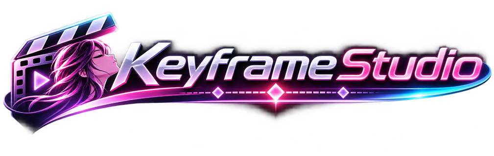
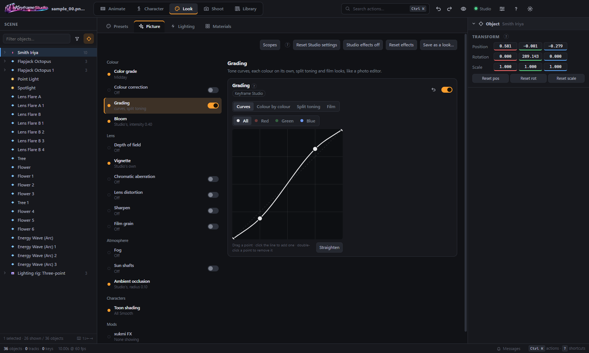
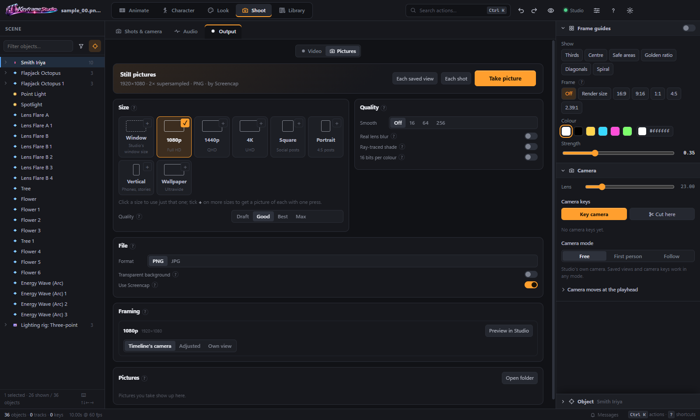
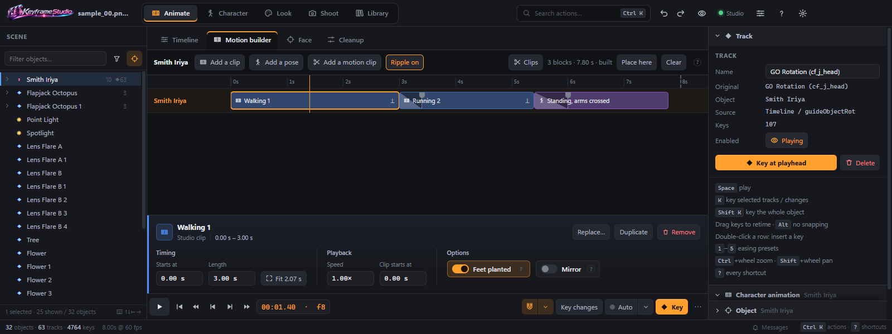
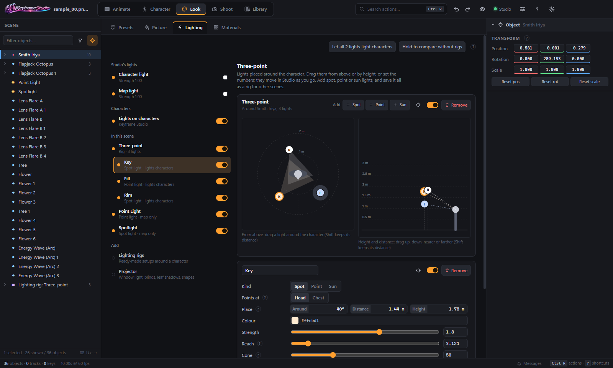

<p align="center">
  
</p>

<p align="center">
  <b>A modern editing window for Koikatsu CharaStudio</b><br>
  Animate, pose, light and render your scenes in a fast, keyboard-friendly app next to Studio —<br>
  with handles and overlays drawn right in Studio's own view.
</p>

<p align="center">
  <a href="../../releases"></a>
  <a href="../../issues/new/choose"></a>
  
  
</p>

<p align="center">
  
</p>

> **Beta.** Keyframe Studio works and is tested against a live CharaStudio, but it's new — expect rough edges.
> Your scenes stay ordinary Timeline scenes, so you can always open them without it.
> [Bug reports](../../issues/new/choose) are the most useful thing you can send.

## Why

CharaStudio is great at rendering and at running every mod you own, but animating in it means nested windows,
tiny gizmos and a lot of clicking. Keyframe Studio keeps Studio doing what it's good at and gives you a proper
editor beside it — ideal on a second monitor:

- **A real timeline.** Dope sheet and graph editor, keys you drag and snap, easing curves, folders, search, undo for everything.
- **Longer motions from Studio's own.** The Motion builder strings animations, poses and your clips together, blended, with feet that stay planted.
- **Pose where you look.** Click a joint in Studio's view and turn it on its rings; drag IK targets, props, lights, cameras and accessories.
- **Light like a 3D program.** Scene lights that really reach characters, rigs around a character, and a lighting maker where you drag lights and watch Studio follow.
- **Everything else in one place.** Faces and lip-sync, looks, grading and effects, cameras and shots, audio, videos and quality stills with several versions at once.
- **Nothing locked in.** Animations are stored by the existing **Timeline** plugin, so scenes stay compatible with vanilla Timeline and other people's setups.

## A quick look

### Pose right in Studio's view

<table>
  <tr>
    <td width="58%"></td>
    <td>
      <b>Skeleton, joints and handles</b> drawn over Studio's own picture — never in your renders.
      Click a joint and turn it on its rings; drag an IK target and only that limb goes to IK.
      FK and IK work together per limb, and scenes reload that way.
      <br><br>
      
      <br><sub>Where markers overlap, rest the pointer and they fan out to pick from.</sub>
      <br><br>
      
      <br><sub>Click the handles' middle — or rest on it — to switch Move / Rotate / Scale.</sub>
    </td>
  </tr>
</table>

### Animate like you would in an animation app

<p align="center"></p>

Dope sheet and graph editor (`Tab`), **Key changes** to key exactly what you moved in Studio, auto-key, snapping
to keys / the playhead / ruler ticks, easing presets and your own saved curves, values you can drag or type, motion
paths and onion-skin ghosts, folders (an eye mutes a whole folder or object), search and a type filter — and one undo history for all of it.

<table>
  <tr>
    <td width="50%"></td>
    <td width="50%"></td>
  </tr>
  <tr>
    <td><b>Face</b> — expressions keyed at the playhead, lip-sync from audio with vowel shapes, natural blinks.</td>
    <td><b>Look</b> — every render setting, built-in effects (grading with tone curves, LUTs, fog, depth of field, grain…), materials, lighting, presets.</td>
  </tr>
  <tr>
    <td></td>
    <td></td>
  </tr>
  <tr>
    <td><b>Shoot</b> — shots and cameras, audio clips, video renders (straight to video, several sizes and framings from one render, audio mixed in), quality stills (many renders averaged, real lens blur, ray-traced shade, 16-bit).</td>
    <td><b>View</b> — overlays, handles, motion paths, ghosts and the camera route, toggled from the bottom bar.</td>
  </tr>
</table>

### Longer motions from Studio's own animations

<p align="center"></p>

The **Motion builder** puts Studio's animations, poses and your motion clips in a row on a lane for each character
and blends each into the next. Drag, trim and blend the blocks; set speed, mirror and **Feet planted**, which keeps
a foot still while it's down, so Studio's on-the-spot walks and runs really cross the floor. It's all built into
ordinary keys you can edit, as one undo step.

### Lighting you can see and drag

<p align="center"></p>

**Look › Lighting** lists Studio's own lights, lights on characters and every light, rig and projector in the scene,
each with a switch, and opens one editor for the one you pick. In the **lighting maker** a rig's lights are drawn
from above and from the side: drag one and it moves in Studio as you drag, drop in spot, point or sun lights, set
each one's place in degrees and metres, and save the rig to fit any character. **Lights on characters** makes scene
lights reach characters like in any 3D program, whatever shader they use, and **Built-in light** turns down the anime
shaders' always-lit look until only your lights light them.

## Get started

**You need:** Koikatsu (or Koikatsu Party) with CharaStudio, BepInEx 5.4 and KKAPI — any HF Patch or BetterRepack
has them — and the **Timeline** plugin for animation. Other plugins (KKPE, MaterialEditor, KKABMX, VideoExport,
Screencap, NodesConstraints, xukmi FX, RealPOV, LockOnPlugin, LightManager, HideAllUI) are used when you have them;
features that need a missing one say so.

1. **Download** the latest zip from [Releases](../../releases) and unzip it anywhere.
2. Start **Keyframe Studio.exe** and press **Set up the bridge**. It finds your Koikatsu folder (or you choose it),
   checks BepInEx and installs the small bridge plugin in one click.
3. Start **CharaStudio**. Keyframe Studio connects by itself — the dot in the top bar turns green.
4. Load a scene, click a character, open **Animate** and press `?` for the shortcuts.

Windows may warn about an unknown publisher the first time (the app isn't code-signed yet): choose
**More info → Run anyway**. The app tells you when a new version is out (a notice in the top bar; it only asks
GitHub for the newest release, and you can turn it off). Updating: replace the folder, then **Settings › About &
diagnostics › Update the bridge**, and restart CharaStudio. **Settings › Help & guide** (`F1`) covers getting
started, good habits and common fixes.
Your presets live in `Koikatsu\UserData\StudioEX` and app settings in `%APPDATA%\studio-ex`, so updates keep them.
**Moving to another PC or sharing a scene:** Library › Scenes › **Move or share** packs the open scene with the audio, poses and
motion clips it uses into one zip (and imports one), and backs up your library (looks, rigs, clips, faces, outfits, templates,
translations) for restoring on the new PC.

## Testing and reporting bugs

Thank you for testing! When something goes wrong:

1. In Keyframe Studio open **Settings (⚙) › About & diagnostics** and press **Copy diagnostics**. It copies versions,
   installed plugins, feature status and the recent logs, with your Windows user name hidden.
2. [Open a bug report](../../issues/new/choose), paste it, and say what you did and what happened.
3. Screenshots help — please keep them **safe for work** (crop or blur anything explicit).

Most edits are one `Ctrl+Z` away, and nothing is saved into your scene until you save it in Studio.
Missed a popup? Everything that popped up is kept in **Messages** in the status bar.

## Workspaces

| Workspace | What's there |
| --- | --- |
| **Animate** (`Ctrl+1`) | Timeline (dope sheet / graph) · Motion builder (with its motion clip shelf) · Face · Cleanup — the transport bar underneath; keyframe or track details on the right |
| **Character** (`Ctrl+2`) | Poses · Posing · Animations · Face shape · Outfit · Body — the selected character's animation, FK/IK, hands, attachments, transform on the right |
| **Look** (`Ctrl+3`) | Presets · Picture (colour, lens, atmosphere, toon — Studio's settings and Keyframe Studio's effects together) · Lighting (Studio's lights, lights on characters, every light, rig and projector in the scene, each with one editor) · Materials — the selected object on the right |
| **Shoot** (`Ctrl+4`) | Shots & camera · Audio · Output (a video or pictures) — the selected object on the right |
| **Library** (`Ctrl+5`) | Scenes · Characters · Objects (every item with pictures) · Templates |
| **Settings** (`Ctrl+,`) | Help & guide (`F1`) · Appearance (dark or light, accent colour) · Mod settings · Studio window · Translations · Shortcuts · About & diagnostics (updates, bug reports) |

The ⚙ menu also has keep-on-top, compact mode, **mini mode** (`Ctrl+Shift+M` — just the timeline in a small
window kept on top of Studio) and saved layouts. The scene menu (the scene's name, top left) saves: **Ctrl+S** saves
over the open scene and keeps the version it replaces in `UserData/StudioEX/scene-backups` (the last 10 of each
scene); **Ctrl+Shift+S** makes a new file, like Studio's Save.

<details>
<summary><b>Every feature</b></summary>

| Area | What you get |
| --- | --- |
| **Viewport overlays** (bottom bar › View) | Drawn in Studio's own view, never in renders: skeleton with clickable joints (blue where FK poses them), IK targets (on their joint when idle), accessories, selection outline, lights (direction, cone, reach), scene cameras, the depth-of-field focus point, names on hover. Where markers overlap, rest the pointer and they fan out into labelled chips to pick from |
| **Viewport handles** | Rings to turn a bone (its axes + a view ring), arrows / cubes / free-move to move and scale objects, lights, cameras, IK targets and accessories; Local or World axes; Ctrl snaps, Shift fine; click the middle (or rest on it) to switch Move / Rotate / Scale. Only the touched part goes to FK (a limb to IK) from the pose on screen — FK and IK work together per limb, and scenes reload that way. Studio's camera holds still over a handle; each drag is one undo. **Drag a hand or foot** and the limb bends to reach it while staying posed by its joints (nothing switches to IK); drag the elbow or knee to swing the limb with the hand or foot planted; Shift for depth, Esc to cancel |
| **Dope sheet** | Tracks grouped per object with summary keys; a character's bone tracks sorted into body parts (Spine & head, Right arm, Face…), closed with their keys on one row and named in words ("Thigh 0"); drag/box select, drag/box select, copy/paste/duplicate, easing hotkeys, context menus, audio lanes, undo/redo. **Snap** lands on keys (this track only / all tracks / none), the playhead, ruler ticks and clip edges, with a line and tag saying what; Alt places freely |
| **Graph editor** (`Tab`) | Real value curves over time. Rotations shown as X/Y/Z degrees (Unity order, unwrapped). Drag keys ↕ to change values, ↔ to retime; double-click a curve to insert a key; normalize mode to overlay different units |
| **Keyframe panel** | Time, and the key's **value to drag or type** (rotations as X/Y/Z degrees; Studio follows live, one drag one undo). Easing to the next key with tangent handles, multi-point curves, presets matching Timeline's, and **My easings** (save your own curves, rename, delete) |
| **Add track** | Every Timeline track type for the selection, plus a **Bones** section: a character's bones and IK targets by body part, each with Rotation / Position — the joint picked in the viewport first |
| **Key changes / Auto-key** | Keyframe Studio notices what you changed in Studio since the last seek (any track type, plus bones/objects without tracks) — **Key changes** keys exactly that; **Auto** (`R`) keys it automatically when you release the mouse. Self-animating things (spinning items, physics bones) are detected and ignored. **Key the whole pose** (timeline header, Character › Posing, Ctrl+K palette) keys a character exactly as it is — place, every joint and target, optionally the face — making the tracks it needs: the way to set a first key; a pose only the animation holds is taken over by joints first, nothing moves, one undo step. Posing in CharaStudio, **Ctrl+K** keys the same way without switching windows (**Ctrl+Shift+K**: the whole object), with a short message in Studio's window; more Studio hotkeys (play, auto-key, frame guides) can be set in Mod settings › Hotkeys in Studio |
| **Motion paths & ghosts** (bottom bar › View) | Paths of hands, feet, head, objects and the camera target over the timeline; onion-skin ghosts at neighbouring keys |
| **Camera route** (bottom bar › View) | Where the camera stands over its keys, drawn in Studio's view with a handle on each key: drag one to put the camera elsewhere at that moment (it keeps aiming at its subject), Shift+drag to move the subject too; one undo step per drag |
| **Organizing tracks** | Group the list by **Objects** or your own **Folders** (Timeline's, saved in the scene) from the timeline toolbar. **Folder** makes one from the selected tracks and names it; drag tracks onto a folder to move them in, onto the Tracks header to take them out; rename, ungroup, open / close all. **Search** (`Ctrl+F`) matches track, object, folder and type names (several words narrow it down); the **type filter** shows only bones, transform, face, character, camera, lights, items, look & effects or other |
| **Foot & hand locking** (Animate › Cleanup) | Keep a foot or hand on one spot over a time range while the body moves: no sliding feet, a hand that stays on the table. Keys the limb's IK target only where needed (within ~2 mm), eases back into its own motion afterwards (0–0.5 s), and warns when the body moves further than the arm or leg reaches. A limb posed with FK switches to IK with its motion kept. **Check foot sliding** offers **Lock** on each slide it finds. One undo step |
| **Cleanup** (Animate › Cleanup) | Lock a foot or hand, smooth, retime, make loop, find and fix sudden moves, check foot sliding — each one undo step. Works on the keys selected in the timeline, or a character's whole tracks in one click |
| **Motion builder** (Animate) | Longer motions from Studio's animations, poses and your motion clips in a row on a lane per character, blended into each other (smooth or linear). Drag to move, trim either end, blend; edges snap to other blocks, the playhead and the ends; ripple, nudge, zoom. Per block: speed, in-point, **mirror**, and **feet planted** (a foot on the ground stays put; Studio's on-the-spot walks and runs travel across the floor). Built into ordinary keys in a Motion folder as one undo step; your edits to those keys are kept through rebuilds; saved with the scene |
| **Motion clips** (Animate › Motion builder › Clips) | Save the selected keys of one character as a clip (body, face, any track type); apply it at the playhead on any character — replace or add on top, strength, blend, speed, repeats; one undo step |
| **Face** (Animate) & **Lip-sync** | Expressions keyed at the playhead; lip-sync from audio (loudness + A/I/U/E/O vowel shapes) with voice per character, part of a clip, style presets, vowel map and all speakers at once; natural blinks |
| **Character** | Animation browser (33k+ clips incl. mods, searchable; also Ctrl+K › Change animation, or right-click a character in the scene list — picking a clip makes it play: FK / IK that would hold the body still go off and a stopped animation starts, one undo), speed/options, FK/IK + parts, eyebrows/eyes/mouth, eye & neck look, blush/tears, hands, outfit + per-slot clothing state, accessories (MoreAccessories slots). Multi-select applies to all selected characters |
| **Posing** (Character) | How each part is posed, in plain words: **Joints** (FK) or a **Target** (IK) per arm, leg and the hips, switched without the pose jumping (also IK → FK), plus neck, fingers, hair, bust and skirt. With KKPE: **target strength** per hand, foot, shoulder, thigh and the body, **bend goals** for elbows and knees, **joint correction** (crotch, ankles), **copy an arm, hand or leg to the other side**, **physics** (bust and buttocks; hair, skirt and accessories as a list with a switch each and one editor), and **every bone** by region. **Colliders** (what hair, skirt and the bust bump into): size, length, outside / inside, centre and direction, by region. A **◆** beside a value keys it at the playhead (its KKPE track is added the first time). One view at a time: Pose, Strength and joints, Physics, Every bone. Each change is one undo step |
| **Poses** (Character) | Studio-compatible pose library (`.dat` and PNG poses, folders, thumbnails), save, apply, **mirror** (`M`), copy pose between characters |
| **Face shape** (Character) | KKPE face parts and shapes on a close-up: one **Size** slider per part, move, turn and shape folded until you need them; shapes in groups that say how many are in use; saved faces and expressions with tags, before/after |
| **Outfit** (Character) | Saved outfits, accessories by body area with Solo, clipping checks |
| **Body** (Character) | ABMX body sliders: click a region on a small figure, pick a part from a short list (each line says its size and whether it's moved or turned), change it in one editor. **Size** keeps the part's proportions; shape, length, move and turn are below. **Both sides together** mirrors left and right the way cards store them; when they differ it says so and copies one side over. Changed only, search adds a bone, reset a region; click a joint in Studio's view and its slider is picked (or offered to add); every change (both sides, a whole region) is one undo step |
| **Prop attachments** (Character) | Right-click an item → **Attach to…** a scene object or a character joint; adjust grip, pause, resume, detach. Requires NodesConstraints |
| **Transform / Object** | Transform for any object (multi-select edits only the axis you touch), item colors/alpha/glow/FK/anim speed, light color/intensity/range/spot/shadows, folder & camera names, view-through-camera |
| **Look** | **Picture**: one list of effects (colour grade, bloom, depth of field, SSAO, vignette, fog, sun shafts, toon shading, and Keyframe Studio's own), grouped into colour, lens, atmosphere and characters, each with a switch and its main value; pick one to edit it. Where Studio and Keyframe Studio both have an effect, both are under one name. **Look presets**: 19 built-in looks (times of day, weather, mood lighting, film styles, Noir, Neon Night, Underwater…), each a colour gradient until its first use; save your own, apply all or some groups at any strength. Keyframe Studio's effects: two-tone fog, colour correction (white balance in kelvin), **Grading** (tone curves, colour by colour, split toning, bleach bypass, density), **LUT files** (.cube / PNG, two slots, light-only or colour-only), bloom, ambient occlusion (radius in metres, shade colour), sharpening, vignette with a lens's natural falloff, lens distortion, spectral fringes, grain, bokeh depth of field (and xukmi FX when installed); all keyable and in videos. **Scopes**: histogram, waveform, RGB parade, vectorscope. **Studio effects off** in one click. **Materials** through KK_MaterialEditor: one material at a time, values grouped by what they do (colours, shadow, shine, rim light, outline…) with a Changed only filter, or one value across every material of a shader. **Lighting**: one list like Picture — Studio's character and map lights, lights on characters, and every light, rig and projector in the scene with its switch — and one editor for the picked one (a light's colour, strength, reach, cone, shadows, whether it lights characters, what it aims at); add rigs around a character (each drawn from above and from the side) and projectors (window light, blinds, leaf shadows); selecting a light in Studio picks it. **Lighting maker**: start a rig of your own or open any rig in the scene — its lights from above and by height and distance; drag them and they move in Studio as you drag (one undo per drag), drop in spot, point or sun lights, set each one's place in degrees and metres, kind, colour, strength, reach, cone and shadows, and save it as a rig that fits any character. **Lights on characters**: scene lights reach characters like in any 3D program — Keyframe Studio draws them onto characters itself (any shader, soft or with a toon edge, keyable strength; **Built-in light** turns down the anime shaders' always-lit look until only lights — Studio's character light included — light the character), or one click puts a character on Az Standard shaders, which take the lights the usual way (one undo, Back to original) |
| **Shots** (Shoot › Shots & camera) | A **shot track** along the timeline: drag shots to move them, drag an edge to trim, drag the edge two shots share to move the cut, drag past a neighbour to swap; split at the playhead, duplicate, snapping to frames, cuts and the playhead; gaps and overlaps shown (one click fixes overlaps). Or a **storyboard** of big pictures with notes, drag to reorder, saved as one picture to share. Each shot has a status (idea, blocked, framed, final), notes, a frame shape, and a camera type: **still** (Studio's view or an angle), **camera keys** (with a camera move across the shot), **first person** through a character's eyes, or **follow** a body part. A **monitor** shows the edit at the playhead through each shot's own camera (your Studio view isn't moved), with the shot's name, timecode, frame and guides. **Angles** keep camera setups to reuse: drag one onto a shot, or onto the empty track for a new shot; each is mirrored in one of Studio's saved views. **Play the edit**: the monitor and renders follow the shots — nothing keyed; a shot with camera keys plays its keys. Studio's own view stays your work camera unless you turn on **In Studio's view too**; a chip in the status bar says when first person or follow has Studio's camera, with Stop. **Transitions** per cut: a hard **cut**, a **glide** (the camera travels between the two shots' cameras; short = a whip pan), a **dip to black / white**, or a **dissolve** — centred on the cut, any length, smooth or linear; shown as a marker and a shaded window on the track, and played in Studio, on the monitor and in renders (Play the edit). **Bake cuts** writes cuts and glides as camera keys (dips and dissolves keep playing from Play the edit). Shots are also draggable on the dope sheet's ruler. Every change is one undo step |
| **Camera & frame guides** (Shoot, on the right) | **Camera**: Studio's lens, **Key camera** / **Cut here**, camera moves (orbit, dolly, crane…), first person, follow, scene cameras. **Frame guides**: thirds, golden ratio, diagonals, spiral, safe areas, frame shapes — drawn on the monitor and in Studio's window, never in renders. **G** turns them all off and back on from anywhere (also the monitor's **Guides** button and the View menu) |
| **Audio** (Shoot) | Any number of clips synced to the timeline, each with volume, balance, speed, fades and trims; lanes in the dope sheet; headphone (Bluetooth) delay; saved with the scene |
| **Video** (Shoot › Output) | Through VideoExport: plays the timeline **through the shots** when Play the edit is on (their cameras, cuts and transitions; shots with camera keys play their keys), audio mixed in, other shapes framed (not squished), several **versions** (sizes and framings) from one render, render queue per shot. **Straight to video** sends frames into the encoder as they render (no image files, no encoding wait); a quick warm-up for physics; **Draft** for fast checks; MP4 encoding balanced, smallest, or on the GPU |
| **Pictures** (Shoot › Output) | Supersampled pictures, PNG/JPG, transparent background, one per saved view or shot, several versions in one press. **Quality**: 16-256 renders averaged in one frame (smooth edges and effects), **real lens blur** at an f-stop (focus on the eyes, the view centre or a distance; a second sharp distance — focus stacking; a tilted focus plane), **ray-traced shade** from the scene's real shapes, **16-bit PNG**, sizes up to what the graphics card holds |
| **Templates** (Library) | A scene's staging without its characters — timeline, shots and cameras, look, lighting rigs, render settings, audio — applied to another scene |
| **Library** | Scene browser (`Ctrl+O`), character cards (add / swap), **Objects** (every item and mod with rendered pictures, big preview from any side, add with one click), templates. Quick actions (record and replay steps) from `Ctrl+K` |
| **Undo everywhere** | One history for timeline, viewport handles, character panel, ABMX, transform, light, item and look edits; a slider or handle drag is one undo step |
| **Appearance** (Settings) | Dark or light theme (or follow Windows) and an accent colour: orange, pink, blue, green or violet |
| **Studio window** (Settings) | Hide Studio's menus and other plugins' panels so it's just the picture (HideAllUI when installed) |
| **Mod settings** (Settings) | Every BepInEx plugin setting (100+ plugins) searchable in one window, plugins grouped by area with the ones changed from default first, typed editors, changed-only filter, reset to default |
| **Translations** (Settings) | Every Japanese string Keyframe Studio has shown, tagged Yours / Machine / Game, opening on the ones that need a look, grouped by where they were seen. **Auto-translate** new names with Google, DeepL or a local AI; results are pushed into AutoTranslator so the in-game UI improves too |

</details>

## Compatibility

Each mod-dependent feature checks the exact classes and members it uses when Studio starts. If a mod is missing
or has changed, only that feature switches off and tells you why; an untested version that still matches stays on
and is marked "untested". When a popular plugin is installed it does the job (so scenes stay compatible with other
people); Keyframe Studio's own version fills in when it's missing.

| Feature | Mod | Tested with |
| --- | --- | --- |
| Animation (dope sheet, graph, keys, auto-key, ghosts) | Timeline | 1.3.0 |
| Face shape: face parts, saved faces, shapes | KKPE | 2.17.0 |
| Bone sliders (ABMX) | KKABMX | 5.2 |
| Look: material tweaks, material rules in presets | Material Editor | 3.7.0 |
| Look: second colour LUT | KK_TwoLut | — |
| Output: video | VideoExport | — |
| Output: pictures with a transparent background | Screencap (BepisPlugins) | — |
| Prop attachments | NodesConstraints | — |
| First person / follow / light aiming / clean window (used when installed) | RealPOV / LockOnPlugin / LightManager / HideAllUI | — |
| FK and IK together on load (kept compatible) | KK_FKIK | — |
| English names | XUnity AutoTranslator | — |

## How it works

```
┌──────────────── CharaStudio ────────────────┐                ┌────────── Keyframe Studio ──────────┐
│ BepInEx · Timeline · KKPE · your mods        │   WebSocket    │ Animate · Character · Look · Shoot  │
│ KKStudioEX.Bridge.dll (overlays & handles) ──┼── 127.0.0.1 ──▶│ Electron + React + TypeScript       │
└──────────────────────────────────────────────┘     :47615     └─────────────────────────────────────┘
```

The **bridge** is a BepInEx plugin (C#, .NET 3.5 / Unity 5.6) with a local WebSocket server: it exposes the
scene and Timeline, draws the overlays and handles in Studio's view, and keeps one shared undo history. It only
listens on your own machine (`127.0.0.1`) and only answers clients holding its token, so web pages can't reach it
([SECURITY.md](SECURITY.md)); the port is in `BepInEx/config/studioex.bridge.cfg`.

<details>
<summary><b>Building from source</b></summary>

| Folder | What |
| --- | --- |
| `plugin/StudioBridge` | The bridge plugin. Builds against your game's own DLLs. |
| `app` | The desktop app (Electron + React + TypeScript + Vite). |
| `shaders` | The Unity 5.6.2f1 project the effect shaders are compiled with (embedded in the bridge). |
| `tests` | Live suites that drive a running CharaStudio through the bridge, and unit tests. |
| `tools` | Packaging: `node tools/package.mjs` makes the portable zip with the bridge inside. |

```powershell
# the bridge (needs the .NET SDK)
cd plugin/StudioBridge
dotnet build -c Release -p:Deploy=true                       # copies to D:\Games\Koikatsu\BepInEx\plugins\KKStudioEX
dotnet build -c Release -p:Deploy=true -p:GameDir="E:\KK"    # another install location

# the app (needs Node 22+)
cd app
npm install
npm run dev      # hot-reloading development mode
npm start        # production build + run

# a release zip (repo root)
node tools/package.mjs
```

**Tests.** Live suites (`tests/suites/*.mjs`) drive a running CharaStudio through the bridge. Each starts from an
empty scene and removes the files it creates. **They replace the scene open in Studio — save first.**

```powershell
npm test                      # every suite (asks before touching Studio)
node tests/run.mjs face look  # suites whose name contains a word (or a number: node tests/run.mjs 35)
node tests/run.mjs --list     # what exists · --yes skips the question · --verbose prints every check
node tests/run.mjs stress     # large-scene stress test (not in the default run)
npm run test:unit             # the pure maths (no Studio needed)
```

The viewport overlays and handles are tested with a simulated mouse (`gizmo.simulate`, suite 35).

**Protocol.** JSON over WebSocket at `ws://127.0.0.1:47615/?token=<token>`, where the token is the contents of
`%APPDATA%\studio-ex\bridge-token` (written by the bridge; connections without it are refused — see
[SECURITY.md](SECURITY.md)). Request `{"id":1,"cmd":"timeline.seek","args":{"t":1.5}}` →
`{"id":1,"ok":true,"result":…}`; the bridge pushes `{"event":"timeline.tick"|"scene.changed"|"selection"|"gizmo.target"|…,"data":…}`.
Commands live in `plugin/StudioBridge/src/Api/*.cs`, wire types in `app/src/bridge/types.ts`.

</details>

## Roadmap

What's done and what's next is in [FUTURE_ROADMAP.md](FUTURE_ROADMAP.md). Next up: code signing and an uninstall
button; click-to-light; editing a camera move's path in the viewport.

## License

[MIT](LICENSE). Keyframe Studio is an unofficial fan tool and isn't affiliated with ILLUSION or the authors of the
plugins it works with.
